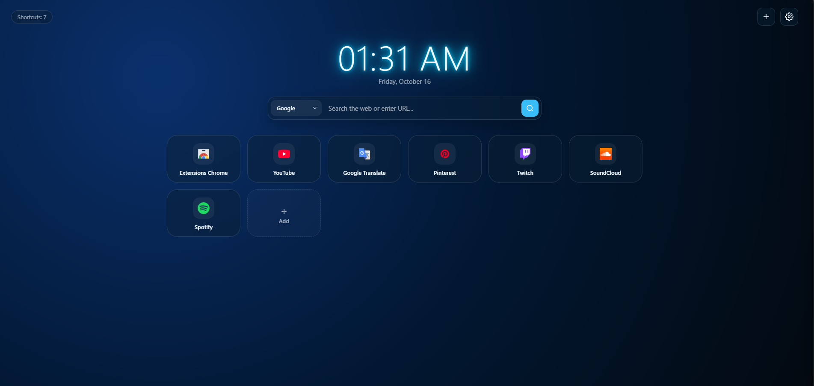
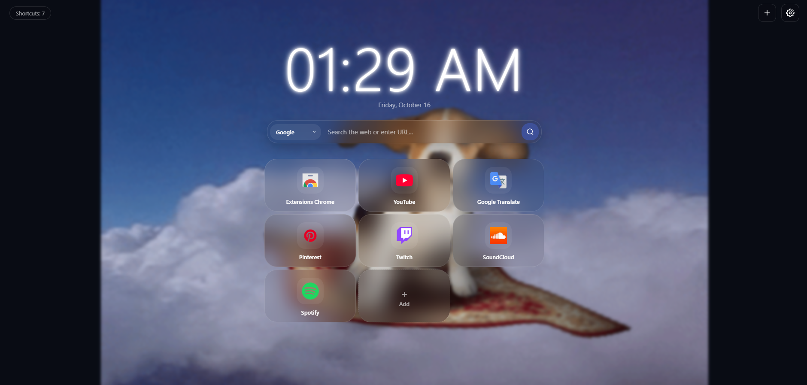

  
  <h1>🌌 Quantum Tab</h1>
  
<b>Custom, beautiful and unlimited new tab page for Google Chrome in Dark Glassmorphism style.</b>

  

    <a href="#english">English</a> • <a href="#russian">Русский</a>
  

  
    
  

---

## 🇬🇧 English

**Quantum Tab** is a modern, highly customizable new tab extension for Google Chrome that breaks the standard 10-shortcut limit and turns your start page into a personal design studio.

### ✨ Key Features
* **🚀 No Shortcut Limits:** Add as many bookmarks as you want; the grid scrolls smoothly.
* **🎨 Customization Studio:** 
  * 8 built-in preset themes (*Obsidian, Cyberpunk 2077, Synthwave, Deep Ocean, Forest Zen, Royal Gold, Crimson Stealth, Frost*).
  * Advanced background builder (Linear/Radial gradients, custom angle, solid color, or custom image/GIF).
  * Built-in wallpaper cropper & resizer (Scale/Zoom, X/Y offset, and tiling).
  * Custom wallpaper upload from PC with automatic WebP optimization.
* **⏰ Live Clock & Neon:** 5 distinct clock font styles, second counter, date, and fully adjustable custom clock neon glow.
* **🔍 Smart Search Bar:** Quick switch between Google, Yandex, DuckDuckGo, and YouTube, with direct URL navigation support.
* **🗂️ Drag & Drop:** Easily rearrange your shortcut cards.
* **🌍 Multi-language:** Supports 10 international languages (English, Russian, Spanish, German, French, Chinese, Japanese, Korean, Portuguese, Arabic).
* **💾 Backup & Sync:** Instant JSON export/import and zero-lag startup via local caching.

### 📥 Installation (Developer Mode)
1. Download or clone this repository.
2. Open Google Chrome and go to `chrome://extensions/`.
3. Enable **Developer mode** in the top right corner.
4. Click **Load unpacked** in the top left corner and select the folder with the extension files.

---

## 🇷🇺 Русский

**Quantum Tab** — это современное и гибко настраиваемое расширение для Google Chrome, которое снимает стандартный лимит в 10 ярлыков и превращает стартовую страницу в полноценную студию дизайна.

### ✨ Основные возможности
* **🚀 Без лимита на закладки:** Добавляйте сколько угодно ярлыков, сетка аккуратно прокручивается вниз.
* **🎨 Студия кастомизации:**
  * 8 готовых премиальных пресетов (*Obsidian, Cyberpunk 2077, Synthwave, Deep Ocean, Forest Zen, Royal Gold, Crimson Stealth, Frost*).
  * Конструктор фона (Линейные/радиальные градиенты, угол наклона, сплошной цвет или своя картинка/GIF).
  * Редактор обоев (масштаб/зум, сдвиг по осям X/Y, режим плитки).
  * Загрузка обоев с компьютера с авто-оптимизацией в WebP.
* **⏰ Живые часы и неон:** 5 стилей шрифта, секунды, дата и тонкая настройка неонового свечения часов.
* **🔍 Умная строка поиска:** Быстрое переключение между Google, Яндекс, DuckDuckGo и YouTube с поддержкой ввода прямых URL.
* **🗂️ Drag-and-Drop:** Перетаскивайте ярлыки мышкой в нужном порядке.
* **🌍 Мультиязычность:** Полный перевод на 10 языков (английский, русский, испанский, немецкий, французский, китайский, японский, корейский, португальский, арабский).
* **💾 Бэкап и кэш:** Экспорт/импорт настроек в JSON и мгновенный запуск за 0 мс без мерцания.

### 📥 Установка (Режим разработчика)
1. Скачайте или клонируйте этот репозиторий.
2. Откройте Google Chrome и перейдите по адресу `chrome://extensions/`.
3. В правом верхнем углу включите **Режим разработчика (Developer mode)**.
4. Нажмите **Загрузить распакованное расширение (Load unpacked)** и выберите папку с проектом.

---

### ❤️ Support the Author / Поддержать автора
If you like this project, you can support its development:  
Если вам нравится проект, вы можете поддержать разработчика:  
[DonatePay — Quantum Tab](https://donatepay.ru/don/quantumtab)

### 📜 License
Distributed under the MIT License. See `LICENSE` for more information.
